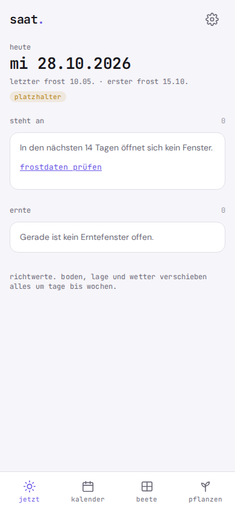
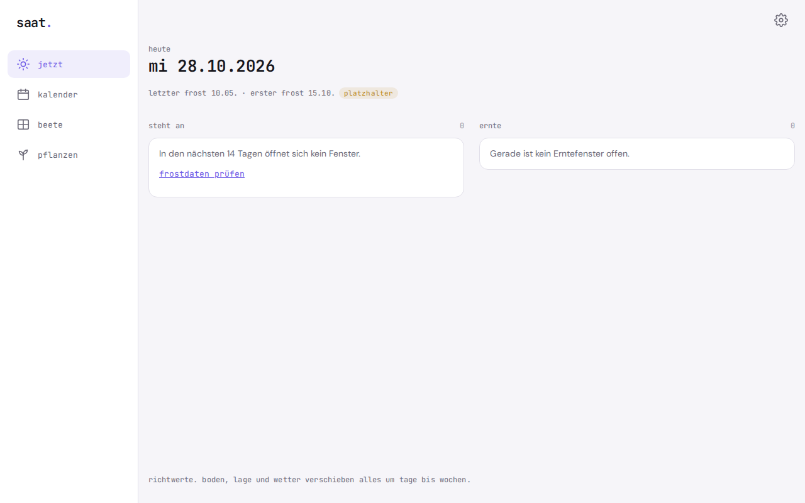

# saat.

**What should I sow right now?** saat. tells you, based on your frost dates and your beds.

saat. is a sowing calendar and garden planner for vegetable beds, raised beds and balcony boxes. It runs as an offline PWA on your phone, needs no account, and your garden data never leaves the device.

   

**Try it:** https://gedachtgemacht.github.io/saat/ (works in any phone browser, install via "Add to Home Screen")

The app interface is in German.

You enter your two frost dates once: the last frost in spring and the first frost in autumn. From those, the app works out the windows for starting seeds indoors, sowing and planting out, for every plant. If you record what grows in your beds, you see the harvest window and a traffic light that shows whether the harvest will be done before the autumn frost.

Plain arithmetic, no AI, no server. Everything stays on your phone.

<p align="center"></p>

<p align="center"></p>

## Why

There are plenty of garden planners, and the good ones are usually subscription apps. What you mostly pay for is one question: what needs doing now, and when can I harvest? For that you need an account, your data sits with the provider, and the apps are full of community feeds, photos and a shop. Dates come as fixed days, even though gardening never works to the exact day.

saat. only does the calendar. No account, no network, and every date is an honest time window.

## Features

- **Frost dates**: last frost in spring and first frost in autumn, as day and month, valid for every year. The defaults 10 May and 15 October are marked as placeholders
- **Plant list** with 14 starting reference values (tomato, pepper, cucumber, zucchini, pumpkin, bush bean, pea, carrot, radish, cut-and-come-again lettuce, spinach, kohlrabi, onion sets, chard), all editable, plus your own plants
- **Time windows** per plant for starting indoors, direct sowing and planting out, in weeks relative to the last frost, plus the growing time as a range in days
- **Beds** with name and note, holding your crops: plant, method (started indoors and planted out, or sown directly) and date
- **Harvest window** per crop as a range, previewed before you save
- **Traffic light** against the autumn frost: **passt** ("fits"), **knapp** ("tight"), **zu spät** ("too late")
- **jetzt** ("now"): what is due in the next 14 days, whether the window is already open or in how many days it opens, plus all open harvest windows with their bed
- **Year calendar**: bars per plant for starting indoors, sowing and planting out across twelve months, with markers for today and both frost dates. Past windows turn grey
- **Export and import** as a JSON file, with a preview before replacing
- **Example data** to try things out, marked as an example and removed with one click
- Light and dark theme, works offline, installable as an app

## Privacy

Nothing leaves your device. saat. has no server, no account, no analytics, no ads, and loads nothing from the network. Frost dates, plants, beds and crops are kept only in your browser's local storage (localStorage). An export file is only created when you trigger it yourself.

Because the data lives only in the browser: if you clear the site data, you also delete saat. So export now and then. The date of your last export is shown in the settings.

## Install

saat. is a static web app. There is no build step and there are no dependencies.

1. Put the `saat/` folder on any static host, for example your own web space. Installing it as an app requires HTTPS.
2. Open the address in your phone's browser.
3. In the browser menu choose **Add to Home Screen**. After that saat. starts like an app and also works without a connection, even in the middle of the garden.

Test locally:

```
cd saat
python3 -m http.server 8000
```

Then open `http://localhost:8000` in your browser.

## How the math works

All dates are plain calendar days. Calculations use `Date.UTC`, so daylight saving time never shifts a day.

**1. Time windows.** Each window is given in weeks relative to the last spring frost; minus means before. Start = frost date + 7 × from, end = frost date + 7 × to.
Example: start tomatoes indoors, -8 to -6 weeks, frost on 10 May 2026: 10 May minus 56 days gives 15 March, minus 42 days gives 29 March. Planting out 0 to 3 weeks: 10 May to 31 May.

**2. Harvest window.** Date of direct sowing or planting out plus growing time, shortest to longest.
Example: tomato planted out on 20 May 2026, growing time 60 to 85 days: harvest 19 July to 13 August.

**3. Traffic light.** Only applies to frost-sensitive plants; all others always get **passt** ("fits"). The comparison is with the first autumn frost in the year of the crop:
- **zu spät** ("too late") if the harvest only starts after the autumn frost
- **knapp** ("tight") if it ends after the autumn frost
- otherwise **passt**. If the harvest ends exactly on the frost day, it still fits

Example: bush bean, growing time 60 to 75 days, autumn frost 15 October 2026: sowing on 20 August gives a harvest from 19 October to 3 November, too late. Sowing on 5 August gives 4 October to 19 October, tight.

**4. What is due.** The **jetzt** ("now") screen shows all windows that start within the next 14 days or are already open and not over today, sorted by start. Plus all crops whose harvest window is open in that period.

**Limits.** Growing time is simplified: it counts from sowing or planting and knows neither varieties nor temperature. The starting list consists of reference values from gardening references, not guarantees. Soil, location and weather shift everything by days to weeks. That is why saat. shows every date as a range, never as a single day.

The calculation functions in `rechnen.js` are pure functions and are tested against these hand calculations with `node test-calc.js`.

## License

GNU Affero General Public License v3.0 (AGPL-3.0), see `LICENSE`.

**Deutsch:** saat. ist ein Aussaatkalender und Gartenplaner für Gemüsebeet, Hochbeet und Balkon, der aus deinen Frostdaten Termine zum Vorziehen, Säen, Pflanzen und Ernten berechnet, offline als PWA und ohne Konto.

---

**gedacht.gemacht.** Small, honest software. Everything stays on your device. · [More projects](https://github.com/gedachtgemacht)
